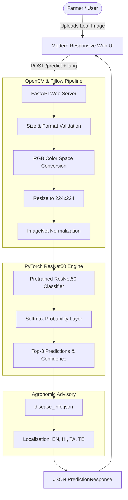

# AgroDetect – Plant Disease Detection System


**AgroDetect** is an end-to-end deep learning web application that diagnoses plant diseases from uploaded leaf images. Built using **PyTorch**, transfer learning with **ResNet50**, **OpenCV**, and **FastAPI**, AgroDetect provides real-time disease classification, confidence scores, visible symptom breakdowns, preventive agricultural measures, and cultural management advice across **10 regional languages**: English, Telugu (తెలుగు), Hindi (हिन्दी), Tamil (தமிழ்), Kannada (ಕನ್ನಡ), Malayalam (മലയാളം), Marathi (मराठी), Bengali (বাংলা), Gujarati (ગુજરાતી), and Punjabi (ਪੰਜਾਬੀ).

---

## Table of Contents

1. [Project Overview & Key Features](#1-project-overview--key-features)
2. [System Architecture](#2-system-architecture)
3. [Folder Structure](#3-folder-structure)
4. [Windows Installation & Setup Guide](#4-windows-installation--setup-guide)
5. [Dataset Acquisition & Preparation](#5-dataset-acquisition--preparation)
6. [Model Training & Evaluation Workflow](#6-model-training--evaluation-workflow)
7. [Running the Application](#7-running-the-application)
8. [Cloud Deployment Guide (Hugging Face / Render)](#8-cloud-deployment-guide)
9. [API Documentation & Swagger UI](#9-api-documentation--swagger-ui)
10. [Automated Testing](#10-automated-testing)
11. [Sample Demonstration Workflow](#11-sample-demonstration-workflow)
12. [Troubleshooting Guide](#12-troubleshooting-guide)
13. [Known Limitations & Future Improvements](#13-known-limitations--future-improvements)

---

## 1. Project Overview & Key Features

- **Plant Leaf Pathology Diagnosis**: Upload leaf photos (JPG, JPEG, PNG up to 10MB) to identify 38 distinct crop-disease conditions.
- **Deep Residual Network (ResNet50)**: Leverages transfer learning with 2,048 extracted feature channels, dropout regularization, and softmax probabilities.
- **OpenCV & Pillow Preprocessing**: Dual-engine image validation, automatic RGB space conversion, resizing (224x224), and ImageNet standardization.
- **Actionable Agronomic Guidance**: Structured symptoms, preventive cultural practices, and general field management from `disease_info.json`.
- **10 Regional Languages**: Instant language switching across English, Telugu, Hindi, Tamil, Kannada, Malayalam, Marathi, Bengali, Gujarati, and Punjabi.
- **Pre-Trained Weights Auto-Loader**: Checkpoint downloads automatically on first launch or during Docker image build.
- **Automated Windows Batch Launcher**: `run.bat` creates virtual environments, installs dependencies, and boots the web server in one click.

---

## 2. System Architecture



---

## 3. Folder Structure

```text
AgroDetect/
├── app/
│   ├── __init__.py
│   ├── main.py                  # FastAPI application with routes and lifecycle
│   ├── model_loader.py          # Singleton model manager with graceful fallback
│   ├── predictor.py             # Inference pipeline and disease lookup
│   ├── preprocessing.py         # OpenCV and Pillow image processing
│   ├── schemas.py               # Pydantic request & response models
│   ├── disease_info.json        # 38-class multilingual knowledge base
│   ├── templates/
│   │   └── index.html           # Modern agricultural frontend
│   └── static/
│       ├── css/
│       │   └── style.css        # Green-and-white responsive stylesheet
│       ├── js/
│       │   ├── script.js        # Drag-and-drop & API integration
│       │   └── translations.js  # Multilingual UI dictionary
│       └── images/
│           └── logo.svg         # High-resolution vector leaf logo
├── training/
│   ├── __init__.py
│   ├── train.py                 # ResNet50 transfer learning training pipeline
│   ├── evaluate.py              # Test set evaluation, metrics, and confusion matrix
│   └── dataset.py               # Dynamic dataset loader and data augmentations
├── models/
│   ├── README.md                # Checkpoint instructions
│   └── class_names.json         # 38 PlantVillage class index mapping
├── tests/
│   ├── __init__.py
│   ├── test_api.py              # FastAPI endpoint tests
│   └── test_preprocessing.py    # Preprocessing and validation tests
├── dataset/
│   ├── README.md                # Dataset download instructions
│   └── download_dataset.py      # Verification and download helper
├── outputs/
│   └── .gitkeep                 # Training curves and confusion matrices
├── requirements.txt             # Python dependency specifications
├── .gitignore                   # Git exclusion rules
├── README.md                    # Project documentation
└── run.bat                      # Windows one-click startup script
```

---

## 4. Windows Installation & Setup Guide

### Step 1: Check Python Version

Ensure **Python 3.10, 3.11, or 3.12 (64-bit)** is installed. Open PowerShell:

```powershell
python --version
```
> If Python is not installed, download it from [python.org](https://www.python.org/downloads/) and ensure **"Add python.exe to PATH"** is checked during installation.

### Step 2: Navigate to Project Folder

```powershell
cd C:\Users\kakan\.gemini\antigravity\scratch\AgroDetect
```

### Step 3: Create and Activate Virtual Environment

```powershell
# Create virtual environment
python -m venv .venv

# Activate virtual environment in PowerShell
.\.venv\Scripts\Activate.ps1
```
*(If you encounter execution policy restrictions in PowerShell, run: `Set-ExecutionPolicy -Scope Process -ExecutionPolicy Bypass`)*

### Step 4: Install Dependencies

```powershell
python -m pip install --upgrade pip
python -m pip install -r requirements.txt
```

> **GPU Acceleration (Optional)**:
> If you have an NVIDIA GPU with CUDA, install the CUDA-enabled PyTorch build:
> ```powershell
> pip install torch torchvision --index-url https://download.pytorch.org/whl/cu118
> ```

---

## 5. Dataset Acquisition & Preparation

AgroDetect uses the **PlantVillage / New Plant Diseases Dataset**, which contains over 87,000 leaf images organized into 38 disease classes.

### Download via Kaggle CLI:

1. Install Kaggle and set up your `kaggle.json` credentials:
   ```powershell
   pip install kaggle
   ```
2. Download and unzip the dataset:
   ```powershell
   kaggle datasets download -d vipoooool/new-plant-diseases-dataset
   Expand-Archive -Path new-plant-diseases-dataset.zip -DestinationPath dataset
   ```
3. Ensure folders are arranged as:
   ```text
   dataset/
   ├── train/
   │   ├── Tomato___Early_blight/
   │   ├── Tomato___healthy/
   │   └── ...
   └── valid/
       ├── Tomato___Early_blight/
       └── ...
   ```
4. Verify dataset structure using our utility:
   ```powershell
   python -m training.dataset --data-dir dataset --verify
   ```

---

## 6. Model Training & Evaluation Workflow

### Training the ResNet50 Architecture

To start transfer learning on your dataset:

```powershell
python -m training.train --data-dir dataset --epochs 15 --batch-size 32 --lr 0.0001
```

**What the training pipeline executes:**
1. Loads class folders dynamically from `dataset/train`.
2. Applies rich data augmentations: random cropping, horizontal and vertical flips, random rotation, color jittering.
3. Initializes `torchvision.models.resnet50` with ImageNet-1K pretrained weights.
4. Replaces the final classification head with a dropout layer (`p=0.3`) and a linear layer matching the exact number of detected classes.
5. Runs training and validation epochs with Adam optimizer and `ReduceLROnPlateau` scheduler.
6. Automatically saves the checkpoint with the highest validation accuracy to `models/best_model.pth`.
7. Saves training and validation loss/accuracy curves to `outputs/training_curves.png`.
8. Saves training metrics to `outputs/training_metrics.json`.

### Evaluating the Model on Test Data

```powershell
python -m training.evaluate --data-dir dataset --model-path models/best_model.pth
```

**What the evaluation script produces:**
- Test cross-entropy loss and overall accuracy.
- Macro and weighted Precision, Recall, and F1-score.
- Complete classification report printed to the console.
- High-resolution confusion matrix heatmap saved to `outputs/confusion_matrix.png`.
- Full evaluation results exported to `outputs/test_metrics.json`.

---

## 7. Running the Application

### Option A: Using the Automated Batch Script
Double-click `run.bat` or run:
```powershell
.\run.bat
```

### Option B: Manual Command Line
```powershell
.\.venv\Scripts\Activate.ps1
python -m uvicorn app.main:app --host 127.0.0.1 --port 8000 --reload
```

Open your browser at: **[http://127.0.0.1:8000](http://127.0.0.1:8000)**

---

## 8. Cloud Deployment Guide

AgroDetect is containerized and ready for 1-click cloud deployment:

- **Hugging Face Spaces (Recommended - 100% Free, 16 GB RAM)**:
  1. Create a new Space at [huggingface.co/new-space](https://huggingface.co/new-space) using **Docker** SDK (Blank template).
  2. Upload the repository files.
  3. The app builds automatically and gives you a permanent public URL: `https://YOUR_USERNAME-agrodetect.hf.space`.
  
- **Render.com**: Connect your GitHub repository to a new Web Service using the included [render.yaml](file:///C:/Users/kakan/.gemini/antigravity/scratch/AgroDetect/render.yaml) blueprint and [Dockerfile](file:///C:/Users/kakan/.gemini/antigravity/scratch/AgroDetect/Dockerfile).

- **Instant Public Link from Laptop**: Double-click [share_online.bat](file:///C:/Users/kakan/.gemini/antigravity/scratch/AgroDetect/share_online.bat) or run `cloudflared tunnel --url http://127.0.0.1:8000`.

See [DEPLOYMENT.md](file:///C:/Users/kakan/.gemini/antigravity/scratch/AgroDetect/DEPLOYMENT.md) for the full step-by-step walkthrough.

---

## 9. API Documentation & Swagger UI

FastAPI automatically provides interactive Swagger documentation. Open:
**[http://127.0.0.1:8000/docs](http://127.0.0.1:8000/docs)**

### Key Endpoints:

| Method | Endpoint | Description |
|---|---|---|
| `GET` | `/` | Serves the interactive web interface |
| `GET` | `/health` | Reports service status, model readiness, and device |
| `GET` | `/classes` | Lists all supported crops and disease classes |
| `GET` | `/disease/{class_name}` | Retrieves localized symptoms and preventive guidance |
| `GET` | `/languages` | Lists supported localization languages |
| `POST` | `/predict` | Uploads image and returns disease diagnosis |

### Example Request (`POST /predict`):

```bash
curl -X POST "http://127.0.0.1:8000/predict?lang=en" \
     -H "accept: application/json" \
     -H "Content-Type: multipart/form-data" \
     -F "file=@tomato_leaf.jpg"
```

### Example JSON Response:

```json
{
  "success": true,
  "predicted_class": "Tomato___Early_blight",
  "display_name": "Tomato - Early Blight",
  "crop": "Tomato",
  "condition": "Early Blight",
  "confidence": 98.42,
  "is_healthy": false,
  "top_predictions": [
    {
      "class_name": "Tomato___Early_blight",
      "display_name": "Tomato - Early Blight",
      "crop": "Tomato",
      "condition": "Early Blight",
      "confidence": 98.42,
      "is_healthy": false
    },
    {
      "class_name": "Tomato___Target_Spot",
      "display_name": "Tomato - Target Spot",
      "crop": "Tomato",
      "condition": "Target Spot",
      "confidence": 1.15,
      "is_healthy": false
    },
    {
      "class_name": "Tomato___healthy",
      "display_name": "Tomato - Healthy",
      "crop": "Tomato",
      "condition": "Healthy",
      "confidence": 0.43,
      "is_healthy": true
    }
  ],
  "disease_info": {
    "disease_name": "Tomato Early Blight (Alternaria linariae / solani)",
    "affected_plant": "Tomato (Solanum lycopersicum)",
    "is_healthy": false,
    "symptoms": [
      "Circular dark brown spots showing distinct concentric rings resembling a target board.",
      "Yellowing (chlorosis) of leaf tissue surrounding the spots.",
      "Progresses from the lower canopy upwards, causing extensive defoliation."
    ],
    "preventive_measures": [
      "Mulch around plant bases to prevent soil-borne fungal spores splashing onto lower leaves.",
      "Stake or trellis tomato plants to keep foliage off the ground and enhance airflow.",
      "Apply preventative fungicides (chlorothalonil, mancozeb, copper) when first fruit cluster forms."
    ],
    "general_management": [
      "Prune off lower foliage (bottom 12 inches) once plants are established.",
      "Remove and safely burn or discard infected leaves; do not add to compost."
    ],
    "disclaimer": "General guidance only. Confirm with a local agricultural extension officer or agronomist before applying chemical treatments."
  },
  "language": "en",
  "inference_time_ms": 42.15
}
```

---

## 10. Automated Testing

Run the test suite with `pytest`:

```powershell
python -m pytest tests/ -v
```

**Tested coverage includes:**
- Preprocessing: JPEG, PNG, RGBA, and Grayscale conversion.
- Preprocessing: ImageNet normalization tensor dimensions `(1, 3, 224, 224)`.
- Input validation: Rejecting corrupted image bytes, empty files, and disallowed extensions (.pdf, .txt).
- API: Homepage loading, health check, classes retrieval, and multilingual queries.
- API: Graceful 503 handling when model checkpoint is not yet generated.
- API: Full end-to-end forward inference with top-3 predictions using test mock classifier.

---

## 11. Sample Demonstration Workflow

Follow this sequence for a college viva or project demonstration:

1. **System Health Check**:
   - Open `http://127.0.0.1:8000/health` in browser or Swagger UI (`/docs`).
   - Show that AgroDetect reports architecture `ResNet50` and detects your hardware compute device.
2. **Interactive UI Tour**:
   - Open `http://127.0.0.1:8000`.
   - Point out the agricultural green-and-white theme, live model readiness badge, and 14 supported crops.
3. **Multilingual Capability**:
   - Change the language dropdown to **తెలుగు (Telugu)**, **हिन्दी (Hindi)**, **தமிழ் (Tamil)**, etc.
   - Show how headers, dropzone instructions, buttons, and clinical advice update immediately in real time.
4. **Leaf Analysis**:
   - Drag and drop a test leaf image onto the dropzone.
   - Observe image dimensions and filesize metadata preview.
   - Click **"Analyze Leaf Condition"**.
   - Review the animated confidence progress meter, primary diagnosis, and top 3 predictions breakdown.
5. **Clinical Agronomic Advisory**:
   - Walk through the three structured advice cards: **Observable Symptoms**, **Recommended Preventive Measures**, and **General Cultural Management**.
   - Highlight the responsible agricultural disclaimer notice.

---

## 12. Troubleshooting Guide

### Issue: "Activate.ps1 cannot be loaded because running scripts is disabled"
**Fix**: Open PowerShell as Administrator or run:
```powershell
Set-ExecutionPolicy -Scope Process -ExecutionPolicy Bypass
```

### Issue: "Port 8000 is already in use"
**Fix**: Specify an alternate port when running Uvicorn:
```powershell
python -m uvicorn app.main:app --port 8080 --reload
```

### Issue: "CUDA out of memory during training"
**Fix**: Reduce batch size in `train.py`:
```powershell
python -m training.train --data-dir dataset --batch-size 16
```

### Issue: "Model checkpoint not found"
**Fix**: Run `python models/download_weights.py` to auto-fetch pretrained weights or train your own with `python -m training.train --data-dir dataset`.

---

## 13. Known Limitations & Future Improvements

- **Single Leaf Focus**: The model is trained on individual leaf photographs against relatively uniform backgrounds. Complex in-field whole-canopy imagery with overlapping foliage may introduce noise.
- **Multiple Simultaneous Diseases**: The current model assumes single-label multi-class classification. Future iterations will incorporate multi-label classification to identify co-occurring infections.
- **Offline Edge Deployment**: Future versions could convert ResNet50 to ONNX or TensorFlow Lite for real-time mobile app execution on low-bandwidth rural smartphones.
- **Automated Weather Advisory**: Integrating real-time weather API data to calculate fungal blight risk indices based on local humidity and temperature.

---

**Developed for Academic Demonstration & Agricultural Empowerment.**
